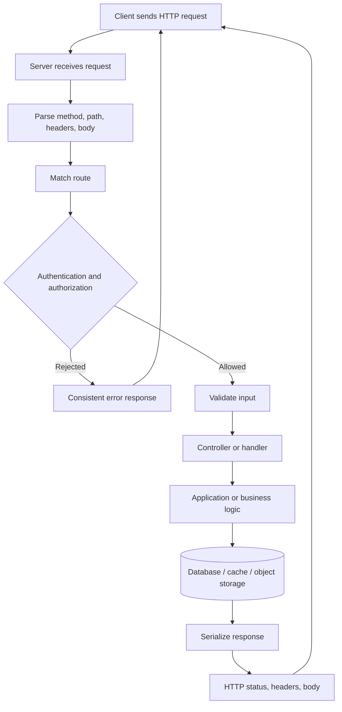

# Backend From First Principles

A visual, hands-on backend engineering curriculum. Learn how a request moves through a backend, then build up the concepts needed to design, secure, scale, test, and operate real services.

> **Start here:** [Open the interactive Backend Mastery Planner](backend-mastery-roadmap.html). Adjust daily study hours, see an automatically recalculated timeline, and expand project cards for topics, build goals, and study guidance.

## Learning path at a glance

```mermaid
flowchart LR
    A[HTTP foundations] --> B[Routing]
    B --> C[Serialization]
    C --> D[Authentication & authorization]
    D --> E[Architecture & REST APIs]
    E --> F[Caching & search]
    F --> G[Task queues]
    G --> H[Errors, configuration & observability]
    H --> I[Graceful shutdown & security]
    I --> J[Performance & concurrency]
    J --> K[Object storage & real-time systems]
    K --> L[Testing & Twelve-Factor apps]
    L --> M[OpenAPI & webhooks]
```

The repository currently contains learning materials for **chapters 5–8, 10–11, and 13–29** (with some chapter numbers not present). Each chapter folder may include an animated HTML lab, visual-notes PDF, and/or a diagram. The links below reflect files currently in the repository.

## Chapters and materials

<strong>Foundations: requests, routes, data, and identity (Chapters 5–8)</strong>

| Chapter | Focus | Interactive lab | Visual notes |
|---|---|---|---|
| 5 | HTTP | [Open lab](<chapter 5/Lesson_05_HTTP_Easy_Animated_Lab.html>) · [Diagram](<chapter 5/mermaid-diagram.png>) | [PDF](<chapter 5/Lesson_05_HTTP_Easy_Visual_Notes.pdf>) |
| 6 | Routing | [Open lab](<chapter 6/Lesson_06_Routing_Easy_Animated_Lab.html>) | [PDF](<chapter 6/Lesson_06_Routing_Easy_Visual_Notes.pdf>) |
| 7 | Serialization and deserialization | [Open lab](<chapter 7/Lesson_07_Serialization_Deserialization_Animated_Lab.html>) · [Diagram](<chapter 7/mermaid-diagram.png>) | [PDF](<chapter 7/Lesson_07_Serialization_Deserialization_Easy_Visual_Notes.pdf>) |
| 8 | Authentication and authorization | [Open lab](<chapter 8/Lesson_08_Authentication_Authorization_Animated_Lab.html>) · [Diagram](<chapter 8/mermaid-diagram.png>) | [PDF](<chapter 8/Lesson_08_Authentication_Authorization_Easy_Visual_Notes.pdf>) |

<strong>API design and architecture (Chapters 10–11)</strong>

| Chapter | Focus | Interactive lab | Visual notes |
|---|---|---|---|
| 10 | Backend architecture | [Open lab](<chapter 10/Lesson_10_Backend_Architecture_Animated_Lab.html>) · [Diagram](<chapter 10/mermaid-diagram.png>) | [PDF](<chapter 10/Lesson_10_Backend_Architecture_Visual_Notes.pdf>) |
| 11 | REST APIs | [Open lab](<chapter 11/REST_API_Lesson11_Lab_FIXED.html>) | [PDF](<chapter 11/REST_API_Lesson11_Notes_FIXED.pdf>) |

<strong>Data, reliability, and operations (Chapters 13–20)</strong>

| Chapter | Focus | Interactive lab | Visual notes |
|---|---|---|---|
| 13 | Caching | [Open lab](<Chapter 13/Lesson_13_Caching_Animated_Lab.html>) · [Diagram](<Chapter 13/mermaid-diagram.png>) | [PDF](<Chapter 13/Lesson_13_Caching_Visual_Notes.pdf>) |
| 14 | Task queues | [Open lab](<chapter 14/Lesson_14_Task_Queues_Animated_Lab.html>) | [PDF](<chapter 14/Lesson_14_Task_Queues_Visual_Notes.pdf>) |
| 15 | Elasticsearch | [Diagram](<Chapter 15/mermaid-diagram.png>) | [PDF](<Chapter 15/Backend_Lesson_15_Elasticsearch_Visual_Notes.pdf>) |
| 16 | Error handling | [Open lab](<chapter 16/Lesson_16_Error_Handling_Animated_Lab.html>) · [Diagram](<chapter 16/mermaid-diagram.png>) | [PDF](<chapter 16/Lesson_16_Error_Handling_Visual_Notes.pdf>) |
| 17 | Configuration management | [Open lab](<chapter 17/Lesson_17_Configuration_Management_Animated_Lab.html>) · [Diagram](<chapter 17/mermaid-diagram.png>) | — |
| 18 | Observability | [Open lab](<chapter18/Lesson_18_Observability_Animated_Lab.html>) | [PDF](<chapter18/Lesson_18_Observability_Visual_Notes.pdf>) |
| 19 | Graceful shutdown | [Open lab](<chapter 19/Lesson_19_Graceful_Shutdown_Animated_Lab.html>) · [Diagram](<chapter 19/mermaid-diagram.png>) | [PDF](<chapter 19/Lesson_19_Graceful_Shutdown_Visual_Notes.pdf>) |
| 20 | Backend security | [Open lab](<chapter20/Lesson_20_Backend_Security_Animated_Lab.html>) · [Diagram](<chapter20/mermaid-diagram.png>) | [PDF](<chapter20/Lesson_20_Backend_Security_Visual_Notes.pdf>) |

<strong>Scale and production practice (Chapters 21–29)</strong>

| Chapter | Focus | Interactive lab | Visual notes |
|---|---|---|---|
| 21 | Scaling and performance | [Part 1 lab](<chapter 21/Lesson_21_1_Scaling_Performance_Animated_Lab.html>) · [Part 2 lab](<chapter 21/Lesson_21_2_Animated_Learning_Lab.html>) · [Diagram](<chapter 21/mermaid-diagram.png>) | [Part 1 PDF](<chapter 21/Lesson_21_1_Scaling_Performance_Visual_Notes.pdf>) · [Part 2 PDF](<chapter 21/Lesson_21_2_Visual_Notes.pdf>) |
| 22 | Concurrency and parallelism | [Open lab](<chapter 22/Lesson_22_Concurrency_Parallelism_Animated_Lab.html>) | [PDF](<chapter 22/Lesson_22_Concurrency_Parallelism_Visual_Notes.pdf>) |
| 23 | Object storage — Part 1 | [Open lab](<chapter 23/Lesson_23_Object_Storage_Part1_Animated_Lab.html>) · [Diagram](<chapter 23/mermaid-diagram.png>) | [PDF](<chapter 23/Lesson_23_Object_Storage_Part1_Visual_Notes.pdf>) · [Additional explanation](<chapter 23/Lesson_23_Object_Storage_Easy_Explained_Revised.pdf>) |
| 24 | Object storage — Part 2 | [Open lab](<chapter 24/Lesson_23_Part2_Object_Storage_Easy_Animated_Lab.html>) | [PDF](<chapter 24/Lesson_23_Part2_Object_Storage_Easy_Visual_Notes.pdf>) |
| 25 | Real-time backends | [Open lab](<chapter 25/Lesson_25_Real_Time_Backends_Easy_Animated_Lab.html>) | [PDF](<chapter 25/Lesson_25_Real_Time_Backends_Easy_Visual_Notes.pdf>) |
| 26 | Testing | [Open lab](<chapter 26/Lesson_26_Testing_Easy_Animated_Lab.html>) | [PDF](<chapter 26/Lesson_26_Testing_Easy_Visual_Notes.pdf>) |
| 27 | Twelve-Factor App principles | [Open lab](<chapter 27/Lesson_27_Twelve_Factor_App_Easy_Animated_Lab.html>) | [PDF](<chapter 27/Lesson_27_Twelve_Factor_App_Easy_Visual_Notes.pdf>) |
| 28 | OpenAPI | [Open lab](<chapter 28/Lesson_28_OpenAPI_Easy_Animated_Lab.html>) | [PDF](<chapter 28/Lesson_28_OpenAPI_Easy_Visual_Notes.pdf>) |
| 29 | Webhooks | [Open lab](<chpater 29/Lesson_29_Webhooks_Easy_Animated_Lab.html>) · [Diagram](<chpater 29/mermaid-diagram.png>) | [PDF](<chpater 29/Lesson_29_Webhooks_Easy_Visual_Notes.pdf>) |

## Request lifecycle flowchart

A useful mental model for the end-to-end path through a typical API. The exact implementation varies by project; use the chapter labs to explore each piece.

## A practical way to study

1. Follow the chapter sequence above and open the animated lab first.
2. Use the visual notes and diagrams to review the concepts.
3. Rebuild the example yourself, then change it and test edge cases.
4. Keep notes on what each layer does and how failures are handled.
5. Use the [interactive planner](backend-mastery-roadmap.html) to plan project work and adapt the schedule to your available study time.

## Repository map

- [`backend-mastery-roadmap.html`](backend-mastery-roadmap.html) — interactive planner with adjustable study hours, projected timeline, project cards, and study tips.
- `chapter N/` — chapter learning materials (folder capitalization and spacing follow the repository's existing names).
- Animated labs are standalone HTML files; PDF notes and diagrams are linked in the chapter tables above.

## Notes

- Chapter folders and materials are linked using their current repository paths; some chapter numbers are not present in the repository yet.
- The planner is a learning aid, not a guarantee of study duration or career outcomes. Adjust estimates to your own pace.
